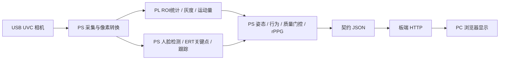

# 架构与实现

VigiLens / 知倦是无接触疲劳与生命体征趋势监测原型。通过眨眼、闭眼时长、PERCLOS、打哈欠、姿态和运动质量提供辅助提示；受控条件下尝试估计心率趋势。质量不满足时拒报。

## 当前板端链路

当前交付候选为 Mizar-Z7020、Buildroot Linux、640×480 YUYV、`ert_temporal`。实际配置来自根 `config.yaml`，构建时导出为 C 参数。候选参数与正式会签口径须按 [interface.md](interface.md) 区分；本次文档整理不升级版本。

PL 承担确定性的像素处理，当前活动链为 `roi_statistic`、`rgb2gray` 和 `motion_quality`。额头 RGB 统计及心率 FIR/频谱估计在 PS 执行；独立的 `fir_filter` 和 `frame_scale` HLS IP 源码保留，不据此声称其已接入当前心率链。五个 IP 的源码、测试台和报告分别在 `fpga/src/`、`fpga/sim/` 和 `fpga/report/`。

## 软硬件接口

- 图像、PL 标量、时间戳与帧号绑定到同一帧；有界队列忙时记录跳帧，不覆盖正在使用的图像。
- 关键点/跟踪、当前图像检查和 PnP 失败时输出不可用；旧检测框只能作为搜索提示。
- 指标使用契约规定的九个顶层字段及六种状态，Python/JS 校验器共同检查；图像走独立旁路。
- ROI 半开区间、RGB 通道、AXI-Stream 行尾/帧首及寄存器定义均以 [接口契约](interface.md) 为准。

## 心率与显示

行为与质量滑窗保持 `window_seconds`；心率独立采用 `rppg_window_seconds`。当前候选为 5 秒、30 Hz 下 150 个有效样本；间隙、运动、姿态、频带与频谱检查仍可能拒报，积满不保证出数。

通过检查的心率估计进入渐进中值与置信指标加权 EMA。参数由 `config.yaml` 统一导出；平滑存在延迟，未证明提高准确性。实现见 `backend/hr_filter.py`、`board/autonomy/hr_filter.h`。

`frontend/hr_display.js` 供 PC 仪表盘和打包板端页面共用。首个有效估计前显示“正在测量”；后续无效/失联时可以保留最近有效数字，但必须标为“历史”并显示年龄。历史缓存不进入契约测量、曲线或告警；设备重启、来源切换时清除。板端 `display.html` 是模板，须经 `package_native_vision.py` 内嵌脚本后使用。

## 代码入口与辅助功能

| 位置 | 用途 |
|---|---|
| `board/autonomy/` | 板端计算、视觉运行时、HTTP、配置导出与打包 |
| `board/cold_boot/` | SD 构建、启动服务与文件校验 |
| `board/w7_buildroot/` | Linux、设备树、USB/PL 数据通路 |
| `board/s4_bench/`、`board/sim/` | 裸机取证与 RTL 对拍 |
| `backend/`、`frontend/` | PC 参考管线、API/WebSocket、仪表盘及辅助功能 |
| `board/video_link/` | 离线视频转运及 PC 语义模拟 |
| `data/` | 标注、黄金参考、年龄参照和数据库 schema |

PC 管线的 MediaPipe、年龄分层旁路与录像工具保留为辅助入口，不代表已在板端部署。板端呼吸率尚未实现。模型和第三方库不随本仓库分发，使用条件见 [已知限制](limitations.md)。
