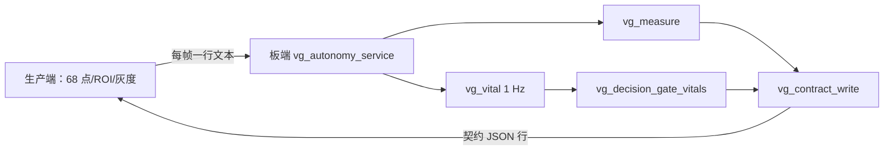

# 2026-10-31 板端自治服务：measure/vital/contract 在板上跑，主机逐字节相同

目标：把「指标决策 + 心率门控 + 契约发布」做成板端服务，先与相机/检测解耦，
让主程序可以逐步替换生产端（PC→板端），而不是一次性重写。

## 结构



- 协议：17 个标量 + 16 个点（32 个坐标），见 `autonomy_service.c` 头注释；
- 服务端不碰相机/模型；`--tcp 9100` 或 stdio；
- 配置来自 `export_config.py`（measure）与**新增** `export_vital_config.py`（vital + 冻结 FIR 系数），
  两者都只读 `config.yaml` / `fir_coeffs_q15.h`，不复制阈值。

## 真板结果【已验证】

| 项 | 结果 |
|---|---|
| 输入 | 656 帧（PC 生产端：68 点 + PnP 姿态 + 额头 RGB + 冻结灰度/运动） |
| 契约帧 | **655**（首帧因 PL 运动量无历史被拒，符合语义） |
| 主机 vs 板端输出 | **逐字节相同**（各 655 行，`diff` 为空） |
| 板端处理耗时 | **mean 0.300 ms/帧**（measure+vital+contract，不含传输） |
| 校验 | 655/655 通过 `backend/contract.validate_frame` |

说明：这只是**服务层**在板上跑通；68 点仍由 PC 生产端提供。
把生产端换成板端相机+检测后，服务与契约不需要改。

### PnP 也放进服务（`--pose pnp`）

服务现在接收 **68 个点**（而不是 16 个），自己跑 `pose_pnp.c`：

| 项 | 结果 |
|---|---|
| 契约帧 | 655（首帧仍被拒） |
| 主机 vs 板端 | 除 `face.pose` 末位外**所有字段相同**（655/655） |
| pose 最大差 | **1.8e-6 度**（x86 vs ARM 浮点） |
| 板端处理耗时 | **mean 9.137 ms/帧**（含每帧 PnP；无 PnP 时 0.300 ms） |

即 PnP 在 A9 上约 **8.8 ms/帧**；若只在 5 Hz 估计姿态，平均成本可摊到 ~1.5 ms/帧。

## 复现

```powershell
# 板端
/tmp/vg_autonomy_service --tcp 9100 --vital-every 30
# PC
python board/autonomy/hybrid_feed.py --points metrics/logs/peppa_68_blink_full.jsonl `
  --source data/raw/blink.mp4 --frames 656 --tcp 169.254.73.29:9100 `
  --output metrics/logs/hybrid_board_full.jsonl
```

主机对照：同一条命令把 `--tcp` 换成 `--stdio .tmp/autonomy/deploy/vg_autonomy_service_host.exe`。

## 边界

- 不是完整自治：检测/68 点仍在 PC；服务不产生图像；
- `vital` 在本段素材仍全 null（21.9 s < 30 s 窗口）；
- 0.300 ms 不含相机、解码、推理与网络。
