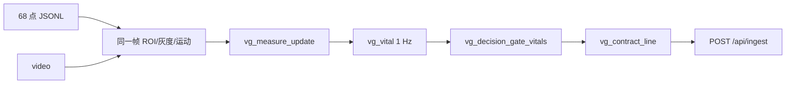

# 2026-10-31 板端契约发布与服务模拟（PC）

对应 [docs/54](../docs/54_板端自治交接_handoff_20261031.md) §5 的 P2「板端契约输出、服务和存储」，
以及 docs/55 的 S6/S7。**全部在本机完成，没有访问板卡。**

## 链路



| 组件 | 文件 | 说明 |
|---|---|---|
| 契约 JSON 写入 | `board/autonomy/contract_json.c/.h` | 只写契约九字段；状态/建议/原因取自 C 决策；UTF-8 转义 |
| 原生绑定 | `board/autonomy/vg_native.py` | ctypes 结构体与 C 头逐字段对应；本地编译缓存 |
| 端到端演示 | `board/autonomy/pc_autonomy_demo.py` | 68 点 + 视频 → C measure → vg_vital → 契约 JSONL |

演示中的**真实项**：C 的 measure/quality/decision/vital/contract 全部执行；
灰度与运动量用冻结的 `backend/quality.to_gray` / `frame_diff_motion`；
每个统计量与 frame_id 同帧绑定；每行都用 `backend/contract.validate_frame` 校验。

**替身项**：`face.pose` 的 yaw/pitch/roll 来自 MediaPipe（68 点尚无 PnP 的 3D 参考），
所以 `pose_migrated=false`；vital 的质量/姿态软恢复未接（丢脸时显式 `vg_vital_reset`）。

## 真实运行【已验证：2026-10-31 本机】

```powershell
. .\env.ps1
python board/autonomy/pc_autonomy_demo.py --points metrics/logs/peppa_68_blink_full.jsonl `
  --source data/raw/blink.mp4 --frames 656 `
  --output metrics/logs/pc_contract_blink.jsonl `
  --summary metrics/logs/pc_contract_blink_summary.json
```

| 项 | 结果 |
|---|---|
| 视频 | 640×480、30 fps、656 帧 |
| 契约帧 | **655**（第 0 帧因 PL 运动量无历史被 C 拒绝，`-2`，符合首帧语义） |
| 契约校验 | **655/655 通过**，0 条错误 |
| 单调性 | ts 0.0333→21.8333，frame_id 连续递增，无回退 |
| 状态分布 | `normal` 510、`adjust_posture` 145（对应转头段） |
| 空 bbox 帧 | 35（几何退化帧，`visible=0`） |
| vital | 全部 null；656 帧 ≈ 21.9 s < 30 s 窗口（900 样本），`vital_not_ready=21` |
| 耗时 | 本机（含 MediaPipe 姿态）数十秒，**不是板端数字** |

`vital` 全 null 不是 bug：这段素材本来就填不满 30 s 窗口（docs/53 已记录同一限制）。
契约里 `hr_bpm` 有值的路径由下面的原生单测用 1000 帧合成序列覆盖。

## 服务模拟【已验证】

```powershell
python backend/api.py --no-mock --port 8123
# 另开一个终端：把 655 帧逐条 POST /api/ingest
```

| 项 | 结果 |
|---|---|
| `POST /api/ingest` | **655 / 655 返回 200**（`{"ok":true,"published":n}`） |
| 用时 | 4.58 s（本机串行 HTTP） |
| `/api/status` | `source="ingest"`，未回退 mock |

这证明 C 端产出的契约帧能被现有 B 线服务直接接收。
图像旁路与"停推不显示冻结旧画面"由既有检查复跑确认：`check_video_bypass.py` **15/15**
（T13 同源预览面板、T14 `PREVIEW_STALE_MS` 过期隐藏）；跨语言契约 `check_frontend_contract.py`
通过（6 帧）。网页视觉呈现本身不在本轮取证范围。

## 原生单测

```powershell
python -m pytest board/autonomy/tests/test_contract_native.py -q   # 6 passed
```

覆盖：合法帧、UTF-8 建议/原因、首帧运动量拒绝、非单调拒绝、缓冲区不足/非法可见度拒绝、
以及 **1000 帧合成 RGB** 下 `vg_vital` 估计 → `vg_decision_gate_vitals` → 契约 `hr_bpm`
非 null 且与估计值一致（`rr_*` 仍为 null）。

## 边界

- 数值格式用 `%.17g`（可往返）；与 Python `repr` 的位数不同，但都是合法 JSON，校验器接受。
- 姿态未迁移，`pose_migrated=false`；不得把 MediaPipe 姿态写成板端 PnP 结果。
- 未上板：编译、libc、计时都是本机的。
- 未写 `report/llm_log/`；未修改契约、阈值或前端。
