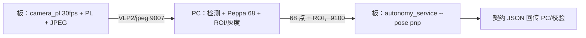

# 2026-10-31 整机混合链路：板相机 → PC 关键点 → 板端服务 → 契约

第一次把真实板相机接进「板端测量/契约」链路，验证整机可运行。

## 链路



## 实测【已验证】

| 项 | 结果 |
|---|---|
| 板相机 | 1280×720、30 fps 分析、JPEG 透传 |
| 请求帧 | 200（另一次 600 帧同样跑通） |
| 检出人脸 | **200/200** |
| 契约帧 | **199**（首帧运动量无历史被拒） |
| 契约校验 | 199/199 通过 |
| 状态 | `normal` 2、`adjust_posture` 197 |
| PC 吞吐 | 12.2 fps → **27.45 fps**（修掉每帧重读 YAML 之后；600 帧时为 13.76） |
| 板端 | PnP + measure/vital/contract 全部在板上 |

`adjust_posture` 不是 bug：板端 PnP 解出 **pitch ≈ −39°**，超过 `pose_pitch_max_deg=25`
（3 帧迟滞后翻状态）。当前相机俯角让人脸明显低头，产品行为就是提示调整姿势。

## 吞吐瓶颈

最初 12–14 fps 是 **PC 侧**：`cProfile` 显示 `to_gray` 每帧都调用 `decim_for_size()`，
而后者每次 `load_config()` 重新解析 YAML —— 单这一项 **31 ms/帧**。
把档位读取加 `lru_cache` 后，同一真板链路 **12.2 → 27.45 fps**（199/199 契约帧）。
剩余成本：720p JPEG 解码 + 逐帧检测 + 灰度 + CRC + TCP 往返。
板端 30 fps 管线本身是 29.9998 fps（长跑已证）。

## 吞吐优化与剩余瓶颈（补充）

- 修掉 `to_gray` 每帧重读 YAML 后：12.2 → **27.45 fps**（纯 TCP）。
- 检测降到每 2 帧 + 保持框：**没有提升**（21–22 fps，带 HTTP），说明瓶颈在
  720p JPEG 解码 + CRC + HTTP 往返，而不是检测本身。

## Web API 闭环（新增）

给 demo 加 `--api` 后，每条合法契约帧同时 POST 到 `backend/api.py`：

| 项 | 结果 |
|---|---|
| 本次运行 | 300 帧请求，契约帧全部 POST |
| `POST /api/ingest` | **161 / 161 返回 200**，0 失败 |
| 吞吐 | 22.02 fps（HTTP 往返比纯 TCP 多约 8 ms/帧） |

即「板相机 → PC 关键点 → 板端 PnP/指标/契约 → 网页 API」已经贯通。

## 边界

- 关键点仍在 PC；板端只做 PL、PnP、measure/vital/contract。
- 没有真人准确率；状态分布只说明门控在工作。
- 相机俯角未调整，因此绝大多数帧是 `adjust_posture`。

## 复现

```powershell
# 板端（一次会话内 60 s 内必须连上，否则 camera_pl 的 accept 超时）
/tmp/vigi_camera_pl_new /dev/video0 1280 720 900 30 16
/tmp/vg_autonomy_service --tcp 9100 --pose pnp
# PC
python board/autonomy/live_hybrid_demo.py --board 169.254.73.29:9007 `
  --service 169.254.73.29:9100 --frames 200 --output metrics/logs/live_contract2.jsonl
```
